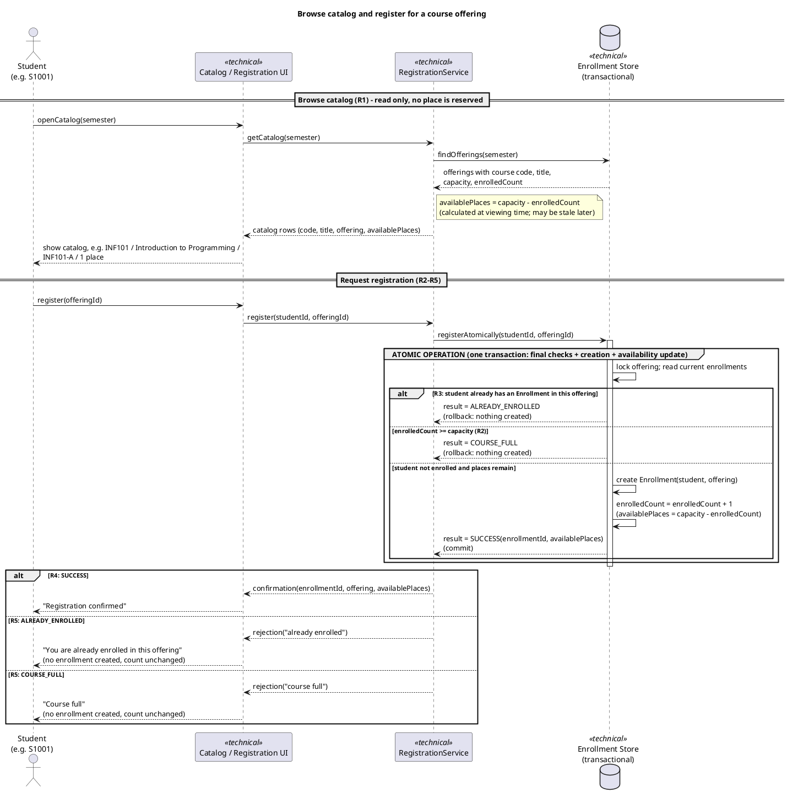
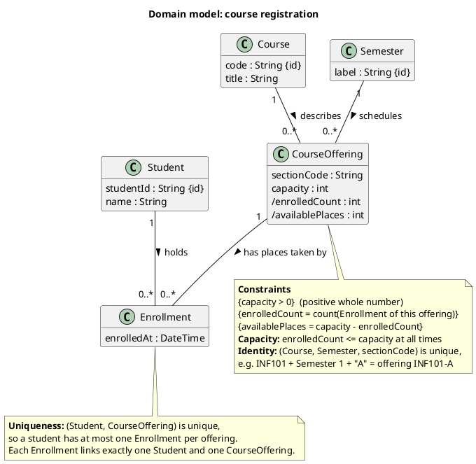
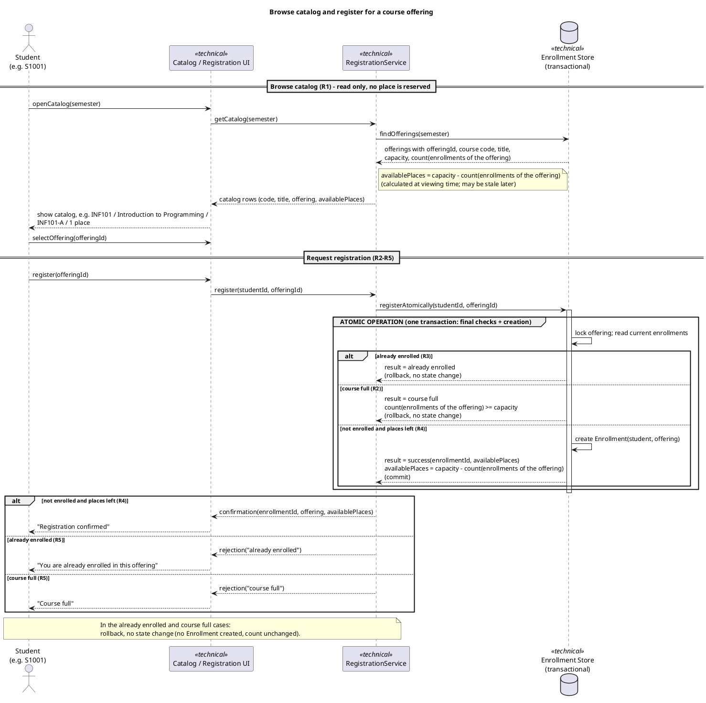
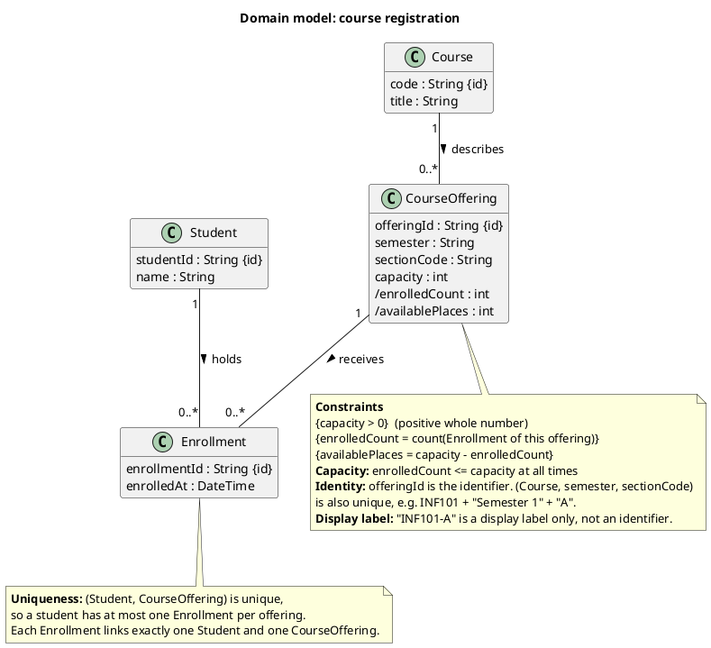

# SIS #02 — AI-Assisted UML Modeling: University Course Registration

<!--
  This is the only file you write your report in. README.md tells you what goes where.

  Rules the checker relies on:
  - Do not delete, rename or renumber the ## headings, the ### headings, or the **Label:** words.
  - Replace every "(write here)" and "(paste here)". None may be left when you submit.
  - Comments like this one are ignored by the checker and the word counter. Delete them or leave them.
-->

## 1. Scope and assumptions

**Scope:** Modeling how a signed-in student registers for one course offering in one semester: browsing the catalog, final capacity and duplicate checks, creating one Enrollment, and issuing either a confirmation or a rejection reason. Out of scope: payments, prerequisites, timetable clashes, waiting lists and cancellation.

**Assumptions:**

1. Students and courses are uniquely identified by student ID and course code; an offering is identified by offeringId, and the combination of course, semester and section is also distinct.
2. A place is taken only when an Enrollment is created, not when the catalog is viewed; the number of taken places equals the number of Enrollments for that offering, and available places are derived from it.
3. If a request fails both checks, the reason "already enrolled" is reported first.
4. A full offering stays in the catalog with 0 available places.
5. The semester is a text label such as "Semester 1".

## 2. User stories and acceptance criteria

### US-01 — Browse offerings

**US-01:** As a signed-in student, I want to see the course offerings for one semester with their available places, so that I can choose an offering to register for.

- **AC-01** (R1): Given Semester 1 has offering INF101-A (title "Introduction to Programming", capacity 2) with 1 Enrollment, When the student opens the catalog for Semester 1, Then the catalog shows the course code INF101, the title, the offering INF101-A and 1 available place.
- **AC-02** (R1): Given INF101-A has 2 Enrollments (capacity 2), When S1001 views the catalog, Then INF101-A is shown with 0 available places and the number of Enrollments for INF101-A is still 2 after viewing, because a catalog view does not take a place.

### US-02 — Register for an offering

**US-02:** As a signed-in student, I want to register for a chosen offering, so that I hold a place in that section.

- **AC-03** (R2, R3, R4): Given INF101-A has capacity 2 and 0 Enrollments, and S1001 has no Enrollment in it, When S1001 requests registration for INF101-A, Then the system rechecks current availability, creates exactly one Enrollment linking S1001 and INF101-A, updates availability to 1 place, and returns a confirmation to S1001.
- **AC-04** (R2, R4): Given INF101-A has capacity 2 and 1 Enrollment (S1001), and S1002 has none, When S1002 requests registration for INF101-A, Then exactly one Enrollment is created, INF101-A has 2 Enrollments (equal to capacity) and 0 available places, and S1002 receives a confirmation.

### US-03 — Receive a clear rejection

**US-03:** As a signed-in student, I want a clear reason when my registration fails, so that I know what happened and that nothing was recorded.

- **AC-05** (R2, R5): Given the catalog showed INF101-A with 1 available place to S1002, another student has since taken it so that INF101-A now has 2 Enrollments (capacity 2), and S1002 has no Enrollment in it, When S1002 requests registration for INF101-A, Then the system rechecks availability, rejects the request with the reason "course full", creates no Enrollment, and the Enrollment count stays at 2.
- **AC-06** (R3, R5): Given S1001 already has an Enrollment in INF101-A and INF101-A has places available, When S1001 requests registration for INF101-A again, Then the system rejects the request with the reason "already enrolled", creates no Enrollment, S1001 still has exactly one Enrollment in INF101-A, and the Enrollment count is unchanged.

## 3. Sequence diagram

<!-- The FINAL diagram, rendered. Change .png to .svg if that is what you exported. -->


**Participants:** Student (the actor); Catalog / Registration UI (the screen); RegistrationService (coordinates the use case and turns results into confirmation or rejection messages); Enrollment Store (the transactional store that holds the Enrollments and offers the lock, commit and rollback).

**Atomic operation:** The group "ATOMIC OPERATION" starts with the message registerAtomically and contains the lock on the offering, the final already-enrolled check (R3), the capacity check (R2) and the creation of the Enrollment (R4) as one transaction, so two competing requests cannot both take the last place. The catalog view reserves nothing: it only reads offerings and counts, computes availablePlaces at viewing time, and the register message carries no availability, so the Store rechecks the current state.

**Where the Enrollment is created:** In the message "create Enrollment(student, offering)" sent by the Enrollment Store to itself, in the last branch (not enrolled and places left). It produces the class Enrollment in section 4.

**Technical lifelines:** Catalog / Registration UI, RegistrationService and Enrollment Store are not classes in the class diagram. They are tagged as technical: they only coordinate the use case and persist data, so the sequence diagram shows who does the work, and the class diagram shows only the domain concepts. The difference in abstraction is fine.

## 4. Class diagram

<!-- The FINAL diagram, rendered. -->


<!-- One row per association in classes.puml, read in both directions. -->
| Association | Read left to right | Read right to left |
| --- | --- | --- |
| Course "1" -- "0..*" CourseOffering : describes > | One Course describes zero or more CourseOfferings. | Each CourseOffering is described by exactly one Course. |
| Student "1" -- "0..*" Enrollment : holds > | One Student holds zero or more Enrollments. | Each Enrollment is held by exactly one Student. |
| CourseOffering "1" -- "0..*" Enrollment : receives > | One CourseOffering receives zero or more Enrollments. | Each Enrollment belongs to exactly one CourseOffering. |

**How an Enrollment links a student to an offering:** An Enrollment sits between the two classes. It has exactly one Student and exactly one CourseOffering, so one Enrollment is one student's place in one offering. The places taken in an offering are its Enrollments.

**Capacity constraint:** The note on CourseOffering states {capacity > 0} and that enrolledCount, which equals the count of its Enrollments, is at most capacity at all times. Multiplicity alone cannot express it, because "0..*" only says that an offering may have any number of Enrollments and cannot compare that number with the value of the capacity attribute.

**Uniqueness constraint:** The note on Enrollment states that the pair (Student, CourseOffering) is unique, so a student has at most one Enrollment per offering (R3). Multiplicity alone cannot express it, because "1" and "0..*" only say that an Enrollment has one student and one offering; they do not forbid two Enrollments with the same pair.

## 5. Traceability

<!-- Every rule, including the catalog fields and availability (R1). Column 1: the rule and
     the criteria that cover it, e.g. "R2 + AC-03, AC-04". Column 2: the message, guard,
     class or constraint that shows the rule in YOUR diagrams. Column 3: the T-ID that
     exercises it, or the extra check you did instead (R1 has no T case). -->

| Rule and criterion | Model evidence | Validation case |
| --- | --- | --- |
| R1 + AC-01, AC-02 | Sequence: findOfferings(semester) and "catalog rows (code, title, offering, availablePlaces)"; class: Course code and title, CourseOffering semester and /availablePlaces | Extra check (R1 has no T case): I compared the catalog row fields with R1 one by one |
| R2 + AC-03, AC-04, AC-05 | Sequence: group "ATOMIC OPERATION", guard "course full" with count(enrollments of the offering) >= capacity; class: capacity note "enrolledCount <= capacity at all times" | T2, T3 |
| R3 + AC-03, AC-06 | Sequence: guard "already enrolled" checked inside the atomic group; class: uniqueness note on Enrollment | T4 |
| R4 + AC-03, AC-04 | Sequence: message "create Enrollment(student, offering)", result success(enrollmentId, availablePlaces), and the confirmation sent only after it | T1, T2 |
| R5 + AC-05, AC-06 | Sequence: rejection("already enrolled"), rejection("course full") and the note "rollback, no state change" | T3, T4 |

## 6. Walkthroughs

<!-- Walk each case through YOUR final sequence diagram, message by message. Column 2: the
     actual steps and the state change (count before → after). Column 3 starts with Pass or
     Fail, then the location: the message, guard or note where you saw it. A Fail you
     report honestly is a finding, not a penalty. -->

| Case | Observed path and state change | Judgment and evidence |
| --- | --- | --- |
| T1. Available | S1001 sends selectOffering and register, the UI forwards register(studentId, offeringId), the service calls registerAtomically, the Store locks the offering, "already enrolled" is false, count 0 >= capacity 2 is false, so it creates one Enrollment and returns success; count goes from 0 to 1 and 1 place is left. | Pass: last branch "not enrolled and places left" inside the ATOMIC OPERATION group, message "create Enrollment(student, offering)", and the confirmation comes after it. |
| T2. Last place | The Store locks the offering, "already enrolled" is false, count 1 >= capacity 2 is false, so it creates one Enrollment and returns success with availablePlaces = 2 - 2; count goes from 1 to 2 and 0 places remain. | Pass: same last branch, result success(enrollmentId, availablePlaces); the capacity is reached but never exceeded. |
| T3. Full | The catalog showed a place earlier, but register carries no availability, so the Store rechecks: "already enrolled" is false, count 2 >= capacity 2 is true, result course full with rollback, no state change; count stays 2. | Pass: branch "course full" in the atomic group, no message creating anything there, then rejection("course full") in the outer alt. |
| T4. Duplicate | The Store locks the offering and the first guard "already enrolled" is true, so the result is already enrolled with rollback, no state change; the capacity check is never reached and the count stays 1. | Pass: first branch "already enrolled", then rejection("already enrolled") in the outer alt; nothing is created or confirmed. |

## 7. Review decisions

<!-- At least three substantive decisions about Prompt C's critique or your own inspection.
     Decision: accepted / rejected / modified — and what you did. Reason: why, in a full
     sentence. Rule: R1–R5. Do not invent an error to fill the table; a justified rejection
     of advice counts. -->

| AI suggestion or model element | Decision | Reason | Rule |
| --- | --- | --- | --- |
| Original and Prompt C D1: sequence step "enrolledCount = enrolledCount + 1" while the class diagram derives /enrolledCount | accepted: step deleted, availablePlaces derived from the Enrollment count | The class diagram says the count is derived, so a stored counter in the sequence could drift from the real Enrollments. | R2, R4 |
| Prompt C D2: enrollmentId and offeringId used in the sequence but missing in the class diagram | accepted: both identifiers added to the classes | Messages must refer to attributes that exist, and "INF101-A" alone is ambiguous across semesters. | R3, R4 |
| Original: extra class Semester with no why-comment and no semester attribute on CourseOffering (my own inspection) | modified: class removed, semester : String added to CourseOffering | The scenario defines an offering as one section in one semester, so a plain attribute is enough. | R1 |
| Original: guards and results named ALREADY_ENROLLED, COURSE_FULL and "R3: student already has..." | modified: guards renamed already enrolled, course full, not enrolled and places left | Names must match AC-05, AC-06 and the wording of R5 so stories, criteria and diagram agree. | R3, R5 |
| Original: capacity and offering identity in one note on CourseOffering (my own inspection) | modified: identity moved to its own note | The assignment asks for capacity and uniqueness constraints to be stated separately. | R2, R3 |
| Prompt C: write the last guard as [else] | rejected | The assignment requires the guard "else not enrolled and places left" without square brackets. | R4 |
| Prompt C: add a database-level unique constraint on (student, offering) | rejected | Database implementation is outside this assignment, and the uniqueness note already states the rule. | R3 |

## 8. Modeling explanation

The sequence diagram and the class diagram answer different questions. 
The sequence diagram shows the order of the work: the student browses a read-only catalog, 
selects an offering and registers, and the Enrollment Store then performs the final already-enrolled check, 
the capacity check and the creation of the Enrollment as one atomic operation. Only after that does the service 
return a confirmation or one of two rejection reasons, and a rejection changes no state. The class diagram shows 
the structure the sequence works on: Student, Course, CourseOffering and Enrollment, 
with multiplicities at both ends and each Enrollment linking exactly one student to one offering.

My main design choices were these. 
First, the Enrollment records are the single source of truth: enrolledCount and availablePlaces are derived, 
so the capacity check counts the Enrollments of the offering instead of updating a stored counter that could 
drift. Second, the checks and the creation sit inside one atomic group, so two competing requests cannot take 
the last place, and a stale catalog view cannot cause overbooking. 
Third, capacity and uniqueness are written as separate notes, 
because multiplicity cannot compare a count with the capacity value or forbid two Enrollments with the 
same student and offering. Fourth, the three technical lifelines appear only in the sequence diagram.

An activity diagram could also help. It would show the same workflow as a flow with decisions: 
"already enrolled" and "course full" are branches, and the success path ends with one Enrollment and
a confirmation. It needs no lifelines, so it explains the rules to a reader who does not need to know
who performs each step, and it lets us check that every branch ends either with one new Enrollment or
with no change.

## 9. Reflection

Prompt B produced both diagrams in nearly finished form in one response, saving me time. A follow-up review in a fresh chat (Prompt C) then exposed an inconsistency: the class diagram calculated enrolledCount from Enrollments, whereas the sequence diagram incremented it as a stored counter. I agreed with this finding and added the missing enrollmentId and offeringId.
One choice I made independently was to reject the advice to write the final guard as [else] and to introduce a unique constraint in the database. The assignment demands the guard “else not enrolled and places left” without square brackets, and database implementation lies outside its scope, so a note about uniqueness seemed sufficient.
Another check against the assignment, went further than the critique. I deleted the redundant Semester class, since the scenario already defines an offering as a single section within one semester, and moved the offering’s identity into a separate note.
One limitation remains. I traced T1–T4 by hand through the diagram, so I have no evidence about truly simultaneous requests; the atomic group is a declared design decision. I also reviewed only two lecture slides.


## 10. Appendix A — Before AI

<!-- Written BEFORE you run Prompt A, committed and pushed in your first commit, and never
     edited afterwards. This is what you paste into Prompt A as "My initial assumptions". -->

**Scope:** Modeling how a signed-in student registers for one course offering in one semester: browsing the catalog, final capacity and duplicate checks, creating one Enrollment, and issuing either a confirmation or a rejection reason.

**Initial assumptions:**

1. Students and courses are uniquely identified by student ID and course code, respectively.
2. A place is taken only when an Enrollment is created, not when the catalog is viewed;
the number of taken places equals the number of Enrollments for that offering.

## 11. Appendix B — AI exchanges

<!-- Complete prompts and complete responses, as text — never screenshots. Paste each inside
     the ~~~~ block that follows its label: AI responses contain ``` PlantUML blocks, and
     ~~~~ keeps them from breaking this file. Prompts B and C: the prompt text first, then
     the material it refers to ("below", "these two") pasted under it, in the same block.
     You may add B5, B6 … after B4 if you ran more. -->

### B1 — Requirements (Prompt A)

- **Tool:** Claude (claude.ai)
- **Model:** Claude Sonnet 5.5
- **Date:** 2026-10-18
- **Purpose:** draft 3 user stories and 6 acceptance criteria

<!-- Model: the exact model with its version, as the tool shows it (e.g. "GPT-5 Thinking",
     "Claude Sonnet 4.5"). If the tool does not show it, write: not displayed
     Date: YYYY-MM-DD -->

**Prompt:**

~~~~text
Act as a requirements analyst. Use only this course registration scenario and rules R1–R5: A student browses an electronic course catalog, chooses a course offering and requests registration. Each offering has a limited number of places. A Course describes a subject. A CourseOffering is one scheduled section in one semester. Registration always targets a specific offering. Assume that the student is signed in, the selected offering exists, and its capacity is a positive whole number. Exclude payments, prerequisites, timetable clashes, waiting lists and cancellation. Use fictional students and courses. R1. Catalog: Show the course code, title, offering and available places for one semester. R2. Capacity: Recheck current availability when registering. Enrollment must never exceed the offering's capacity. R3. Duplicates: A student may have at most one enrollment in the same offering. Reject a repeat request. R4. Success: Create exactly one Enrollment linking the student and offering, update availability and return a confirmation. R5. Rejection: Explain "course full" or "already enrolled". Create no enrollment and leave the enrollment count unchanged. My initial assumptions are (1) Students and courses are uniquely identified by student ID and course code, respectively. (2) A place is taken only when an Enrollment is created, not when the catalog is viewed; the number of taken places equals the number of Enrollments for that offering.
Draft 3 user stories and 2 Given / When / Then acceptance criteria for each. Use IDs US-01 to US-03 and AC-01 to AC-06. Map each criterion to rule IDs.
Cover normal and rejection behavior. List uncertainty separately. Do not add excluded features or invent university policies.
~~~~

**Response:**

~~~~text
# Requirements: Course Registration

**Fictional data used:** students S1001 (Aiya), S1002 (Bek); course INF101 "Introduction to Programming"; offering INF101-A, Semester 1, capacity 2.

**Working definitions** (from your assumptions)
- Taken places = number of Enrollments for that offering.
- Available places = capacity − taken places.

---

## US-01: Browse the catalog
As a signed-in student, I want to see the course offerings for one semester with their available places, so that I can choose an offering to register for.

**AC-01: Catalog lists the semester's offerings** (R1)
- **Given** Semester 1 has offering INF101-A (title "Introduction to Programming", capacity 2) with 1 Enrollment
- **When** the student opens the catalog for Semester 1
- **Then** the catalog shows the course code INF101, the title, the offering INF101-A and 1 available place.

**AC-02: Viewing does not take a place; a full offering shows no places** (R1, R2)
- **Given** INF101-A has 2 Enrollments (capacity 2) and S1001 is not enrolled
- **When** S1001 views the catalog
- **Then** INF101-A is shown with 0 available places, and the number of Enrollments for INF101-A is still 2 after viewing.

---

## US-02: Register for an offering
As a signed-in student, I want to register for a chosen offering, so that I hold a place in that section.

**AC-03: Successful registration** (R2, R3, R4)
- **Given** INF101-A has capacity 2 and 0 Enrollments, and S1001 has no Enrollment in it
- **When** S1001 requests registration for INF101-A
- **Then** the system rechecks current availability, creates exactly one Enrollment linking S1001 and INF101-A, and shows 1 available place.
- **And** it returns a confirmation to S1001.

**AC-04: Registration takes the last place** (R2, R4)
- **Given** INF101-A has capacity 2 and 1 Enrollment (S1001), and S1002 has none
- **When** S1002 requests registration for INF101-A
- **Then** exactly one Enrollment is created, INF101-A has 2 Enrollments (equal to capacity) and 0 available places, and S1002 receives a confirmation.

---

## US-03: Understand why a registration is rejected
As a signed-in student, I want a clear reason when my registration fails, so that I know what happened and that nothing was recorded.

**AC-05: Rejection because the offering is full** (R2, R5)
- **Given** the catalog showed INF101-A with 1 available place, and before S1002 submits, another student takes it, so INF101-A now has 2 Enrollments (capacity 2)
- **When** S1002 requests registration for INF101-A
- **Then** the system rechecks availability and rejects the request with the reason "course full".
- **And** no Enrollment is created and the Enrollment count stays at 2.

**AC-06: Rejection because the student is already enrolled** (R3, R5)
- **Given** S1001 already has an Enrollment in INF101-A, and INF101-A has places available
- **When** S1001 requests registration for INF101-A again
- **Then** the system rejects the request with the reason "already enrolled".
- **And** no Enrollment is created, S1001 still has exactly one Enrollment in INF101-A, and the Enrollment count is unchanged.

---

## Traceability

| AC | Story | Type | Rules |
|---|---|---|---|
| AC-01 | US-01 | Normal | R1 |
| AC-02 | US-01 | Edge (full) | R1, R2 |
| AC-03 | US-02 | Normal | R2, R3, R4 |
| AC-04 | US-02 | Boundary | R2, R4 |
| AC-05 | US-03 | Rejection | R2, R5 |
| AC-06 | US-03 | Rejection | R3, R5 |

Every rule is covered: R1 by AC-01 and AC-02, R2 by AC-02 to AC-05, R3 by AC-03 and AC-06, R4 by AC-03 and AC-04, and R5 by AC-05 and AC-06.

---

## Uncertainties (not resolved here)

1. **Both rejection reasons apply.** If a student is already enrolled and the offering is also full, R5 does not say which reason to show. AC-05 and AC-06 are written so that only one condition holds at a time.
2. **Simultaneous requests.** R2 says enrollment must never exceed capacity, but not how two near-simultaneous requests for the last place are handled. AC-05 covers a stale catalog, not true concurrency.
3. **Identifying an offering.** The scenario does not say what uniquely identifies a CourseOffering (for example course code plus semester plus section). I used "INF101-A, Semester 1" for illustration only.
4. **How the semester is chosen in the catalog.** R1 says "one semester" but not whether the student picks it or the system supplies it.
5. **Zero-place offerings in the catalog.** R1 does not say whether full offerings must be listed. AC-02 assumes they are shown with 0 places.
6. **Confirmation content.** R4 says "return a confirmation" without saying what it contains. My criteria only require that one is returned.
7. **Different offerings of the same course.** R3 covers only the same offering. Whether a student may enroll in two offerings of the same course is not stated, and I have not added a rule for it.
8. **Rejection wording.** R5 gives only the two reasons, "course full" and "already enrolled". Exact message text and format are unspecified.
~~~~

### B2 — UML drafts (Prompt B)

- **Tool:** Claude (claude.ai)
- **Model:** Claude Sonnet 5.5
- **Date:** 2026-10-18
- **Purpose:** draft the sequence and class diagrams

**Prompt:**

~~~~text
Using my approved scenario, R1–R5, stories and criteria below, return separate PlantUML code blocks for a sequence diagram and a domain class diagram.
Sequence: include catalog browsing and guarded success, full-course and duplicate outcomes. Model final checks and creation as one atomic operation.
Class: show domain concepts, useful attributes and multiplicities. State the capacity and uniqueness constraints. Explain assumptions and any technical lifelines.

Scenario: A student browses an electronic course catalog, chooses a course offering and requests registration. Each offering has a limited number of places. A Course describes a subject. A CourseOffering is one scheduled section in one semester. Registration always targets a specific offering. Assume that the student is signed in, the selected offering exists, and its capacity is a positive whole number. Exclude payments, prerequisites, timetable clashes, waiting lists and cancellation. Use fictional students and courses.

R1. Catalog: Show the course code, title, offering and available places for one semester.
R2. Capacity: Recheck current availability when registering. Enrollment must never exceed the offering's capacity.
R3. Duplicates: A student may have at most one enrollment in the same offering. Reject a repeat request.
R4. Success: Create exactly one Enrollment linking the student and offering, update availability and return a confirmation.
R5. Rejection: Explain "course full" or "already enrolled". Create no enrollment and leave the enrollment count unchanged.


```

### US-01 — Browse offerings

**US-01:** As a signed-in student, I want to see the course offerings for one semester with their available places, so that I can choose an offering to register for.

- **AC-01** (R1): Given Semester 1 has offering INF101-A (title "Introduction to Programming", capacity 2) with 1 Enrollment, When the student opens the catalog for Semester 1, Then the catalog shows the course code INF101, the title, the offering INF101-A and 1 available place.
- **AC-02** (R1): Given INF101-A has 2 Enrollments (capacity 2), When S1001 views the catalog, Then INF101-A is shown with 0 available places and the number of Enrollments for INF101-A is still 2 after viewing, because a catalog view does not take a place.

### US-02 — Register for an offering

**US-02:** As a signed-in student, I want to register for a chosen offering, so that I hold a place in that section.

- **AC-03** (R2, R3, R4): Given INF101-A has capacity 2 and 0 Enrollments, and S1001 has no Enrollment in it, When S1001 requests registration for INF101-A, Then the system rechecks current availability, creates exactly one Enrollment linking S1001 and INF101-A, updates availability to 1 place, and returns a confirmation to S1001.
- **AC-04** (R2, R4): Given INF101-A has capacity 2 and 1 Enrollment (S1001), and S1002 has none, When S1002 requests registration for INF101-A, Then exactly one Enrollment is created, INF101-A has 2 Enrollments (equal to capacity) and 0 available places, and S1002 receives a confirmation.

### US-03 — Receive a clear rejection

**US-03:** As a signed-in student, I want a clear reason when my registration fails, so that I know what happened and that nothing was recorded.

- **AC-05** (R2, R5): Given the catalog showed INF101-A with 1 available place to S1002, another student has since taken it so that INF101-A now has 2 Enrollments (capacity 2), and S1002 has no Enrollment in it, When S1002 requests registration for INF101-A, Then the system rechecks availability, rejects the request with the reason "course full", creates no Enrollment, and the Enrollment count stays at 2.
- **AC-06** (R3, R5): Given S1001 already has an Enrollment in INF101-A and INF101-A has places available, When S1001 requests registration for INF101-A again, Then the system rejects the request with the reason "already enrolled", creates no Enrollment, S1001 still has exactly one Enrollment in INF101-A, and the Enrollment count is unchanged.
```
~~~~

**Response:**

~~~~text
Both diagrams are below, followed by the assumptions and the technical lifelines.

## 1. Sequence diagram



## 2. Domain class diagram



## Assumptions

- **Check order:** if a request would fail both checks (the student is already enrolled and the offering is full), I report "already enrolled", because it is the more specific reason. Your criteria don't cover this case, so change the order if you prefer.
- **Atomic operation:** the final duplicate check, the capacity check, the creation of the Enrollment and the availability update form a single transaction. Two concurrent requests for the last place therefore can't both succeed, which is what R2 and AC-05 require. A rejection rolls back, so no Enrollment is created.
- **Catalog:** the catalog is read-only. The availability it shows can be stale by the time the student registers, which is why registration rechecks it (AC-05).
- **Derived attributes:** `enrolledCount` and `availablePlaces` are derived (marked `/`) from the Enrollment links, so they cannot drift from the real data.
- **Semester:** I modelled it as its own class because R1 filters the catalog by semester. If you only want a plain attribute on CourseOffering, it can be folded in.
- **Confirmation and rejection:** these are messages, not domain classes, so they appear only in the sequence diagram.
- **Excluded:** payments, prerequisites, timetable clashes, waiting lists and cancellation are not modelled. Sign-in is assumed, and the offering is assumed to exist.

## Technical lifelines

These are not domain concepts, so they appear only in the sequence diagram and are tagged `<<technical>>`:

- **Catalog / Registration UI:** the screen the student interacts with.
- **RegistrationService:** the application service that coordinates the use case and maps results to confirmation or rejection messages.
- **Enrollment Store (transactional):** the persistence layer that provides the atomic boundary. Locking, commit and rollback happen here, so the domain diagram does not need them.
~~~~

### B3 — Model critique (Prompt C)

- **Tool:** Claude (claude.ai)
- **Model:** Claude Sonnet 5.5
- **Date:** 2026-10-18
- **Purpose:** review both models against R1–R5 and T1–T4

**Prompt:**

~~~~text
Review these two UML models against R1–R5 and my acceptance criteria. Check message order, guards, state changes, multiplicities and naming.
Inspect the four validation cases: available places, exactly one place, full course after a stale catalog view, and duplicate registration.
For each issue, cite the affected rule and model element. Explain the impact and propose a focused correction. Separate genuine defects from optional design choices.

R1. Catalog: Show the course code, title, offering and available places for one semester.
R2. Capacity: Recheck current availability when registering. Enrollment must never exceed the offering's capacity.
R3. Duplicates: A student may have at most one enrollment in the same offering. Reject a repeat request.
R4. Success: Create exactly one Enrollment linking the student and offering, update availability and return a confirmation.
R5. Rejection: Explain "course full" or "already enrolled". Create no enrollment and leave the enrollment count unchanged.

Sequence diagram (sequence.puml):
@startuml
title Browse catalog and register for a course offering
skinparam sequenceMessageAlign left
skinparam responseMessageBelowArrow true

actor "Student\n(e.g. S1001)" as Student
participant "Catalog / Registration UI" as UI <<technical>>
participant "RegistrationService" as Svc <<technical>>
database "Enrollment Store\n(transactional)" as Store <<technical>>

== Browse catalog (R1) - read only, no place is reserved ==
Student -> UI : openCatalog(semester)
UI -> Svc : getCatalog(semester)
Svc -> Store : findOfferings(semester)
Store --> Svc : offerings with course code, title,\ncapacity, enrolledCount
note right of Svc
  availablePlaces = capacity - enrolledCount
  (calculated at viewing time; may be stale later)
end note
Svc --> UI : catalog rows (code, title, offering, availablePlaces)
UI --> Student : show catalog, e.g. INF101 / Introduction to Programming /\nINF101-A / 1 place

== Request registration (R2-R5) ==
Student -> UI : register(offeringId)
UI -> Svc : register(studentId, offeringId)

Svc -> Store : registerAtomically(studentId, offeringId)
activate Store

group ATOMIC OPERATION (one transaction: final checks + creation + availability update)
  Store -> Store : lock offering; read current enrollments
  alt R3: student already has an Enrollment in this offering
    Store --> Svc : result = ALREADY_ENROLLED\n(rollback: nothing created)
  else enrolledCount >= capacity (R2)
    Store --> Svc : result = COURSE_FULL\n(rollback: nothing created)
  else student not enrolled and places remain
    Store -> Store : create Enrollment(student, offering)
    Store -> Store : enrolledCount = enrolledCount + 1\n(availablePlaces = capacity - enrolledCount)
    Store --> Svc : result = SUCCESS(enrollmentId, availablePlaces)\n(commit)
  end
end
deactivate Store

alt R4: SUCCESS
  Svc --> UI : confirmation(enrollmentId, offering, availablePlaces)
  UI --> Student : "Registration confirmed"
else R5: ALREADY_ENROLLED
  Svc --> UI : rejection("already enrolled")
  UI --> Student : "You are already enrolled in this offering"\n(no enrollment created, count unchanged)
else R5: COURSE_FULL
  Svc --> UI : rejection("course full")
  UI --> Student : "Course full"\n(no enrollment created, count unchanged)
end
@enduml

Class diagram (classes.puml):
@startuml
title Domain model: course registration
hide empty methods
skinparam classAttributeIconSize 0

class Student {
  studentId : String {id}
  name : String
}

class Course {
  code : String {id}
  title : String
}

class Semester {
  label : String {id}
}

class CourseOffering {
  sectionCode : String
  capacity : int
  /enrolledCount : int
  /availablePlaces : int
}

class Enrollment {
  enrolledAt : DateTime
}

Course "1" -- "0..*" CourseOffering : describes >
Semester "1" -- "0..*" CourseOffering : schedules >
Student "1" -- "0..*" Enrollment : holds >
CourseOffering "1" -- "0..*" Enrollment : has places taken by >

note bottom of CourseOffering
  **Constraints**
  {capacity > 0}  (positive whole number)
  {enrolledCount = count(Enrollment of this offering)}
  {availablePlaces = capacity - enrolledCount}
  **Capacity:** enrolledCount <= capacity at all times
  **Identity:** (Course, Semester, sectionCode) is unique,
  e.g. INF101 + Semester 1 + "A" = offering INF101-A
end note

note bottom of Enrollment
  **Uniqueness:** (Student, CourseOffering) is unique,
  so a student has at most one Enrollment per offering.
  Each Enrollment links exactly one Student and one CourseOffering.
end note
@enduml

Acceptance criteria:
- AC-01 (R1): Given Semester 1 has offering INF101-A (title "Introduction to Programming", capacity 2) with 1 Enrollment, When the student opens the catalog for Semester 1, Then the catalog shows the course code INF101, the title, the offering INF101-A and 1 available place.
- AC-02 (R1): Given INF101-A has 2 Enrollments (capacity 2), When S1001 views the catalog, Then INF101-A is shown with 0 available places and the number of Enrollments for INF101-A is still 2 after viewing, because a catalog view does not take a place.
- AC-03 (R2, R3, R4): Given INF101-A has capacity 2 and 0 Enrollments, and S1001 has no Enrollment in it, When S1001 requests registration for INF101-A, Then the system rechecks current availability, creates exactly one Enrollment linking S1001 and INF101-A, updates availability to 1 place, and returns a confirmation to S1001.
- AC-04 (R2, R4): Given INF101-A has capacity 2 and 1 Enrollment (S1001), and S1002 has none, When S1002 requests registration for INF101-A, Then exactly one Enrollment is created, INF101-A has 2 Enrollments (equal to capacity) and 0 available places, and S1002 receives a confirmation.
- AC-05 (R2, R5): Given the catalog showed INF101-A with 1 available place to S1002, another student has since taken it so that INF101-A now has 2 Enrollments (capacity 2), and S1002 has no Enrollment in it, When S1002 requests registration for INF101-A, Then the system rechecks availability, rejects the request with the reason "course full", creates no Enrollment, and the Enrollment count stays at 2.
- AC-06 (R3, R5): Given S1001 already has an Enrollment in INF101-A and INF101-A has places available, When S1001 requests registration for INF101-A again, Then the system rejects the request with the reason "already enrolled", creates no Enrollment, S1001 still has exactly one Enrollment in INF101-A, and the Enrollment count is unchanged.
~~~~

**Response:**

~~~~text
## Overall verdict

The two models are largely sound. All four validation cases produce the outcomes the acceptance criteria require, and the message order is correct. I found **two genuine defects**, both about consistency between the two diagrams rather than about behavior. The rest are optional design choices.

## Validation cases

| Case | ACs | Trace through the models | Result |
|---|---|---|---|
| Available places | AC-01, AC-02, AC-03, AC-04 | Browse is read-only and shows capacity − enrolledCount (2 − 1 = 1). Registering with 0 enrollments goes through both guards, creates one Enrollment and gives 1 place left. | Pass |
| Exactly one place | AC-04 | With 1 of 2 taken, the guard `enrolledCount >= capacity` is false. After creation the count is 2 and availability is 0, so the count equals capacity and never exceeds it. The offering lock keeps two simultaneous requests from both passing. | Pass |
| Full after stale catalog | AC-05 | `register(studentId, offeringId)` carries no catalog-time availability, so only the Store's current state decides. S1002 is not enrolled, so the R3 guard is false, the R2 guard is true, and the result is COURSE_FULL with `rejection("course full")`, no Enrollment and the count staying at 2. | Pass |
| Duplicate registration | AC-06 | The R3 guard is evaluated first and does not depend on availability, so the result is ALREADY_ENROLLED, nothing is created and the count is unchanged. | Pass |

## Genuine defects

**D1. `enrolledCount` is derived in one model and stored in the other (R2, R4; CourseOffering and the atomic group)**
- The class diagram declares `/enrolledCount` as derived, constrained to `count(Enrollment of this offering)`.
- The sequence diagram does three conflicting things. It "reads current enrollments", then guards on `enrolledCount >= capacity`, then executes `enrolledCount = enrolledCount + 1`.
- Impact: it is unclear what the source of truth for the R2 check is. If the count is a stored counter, it can drift from the real Enrollments, and R2 would then be enforced against the wrong number.
- Correction (preferred): make the Enrollment rows the single source of truth.
  - Guard: `count(enrollments of offering) >= capacity`.
  - Success path: create the Enrollment, then derive `availablePlaces = capacity − count(enrollments)`.
  - Delete the increment step.
- Alternative: keep a stored counter, but drop the `/` in the class diagram and mark it as a maintained cache whose invariant is the existing constraint.

**D2. The identifiers used in the sequence do not exist in the class model, and `offeringId` is ambiguous (R3, R4; Enrollment, CourseOffering, `register(studentId, offeringId)`)**
- `SUCCESS(enrollmentId, …)` returns an `enrollmentId`, but Enrollment has no identifier attribute.
- `offeringId` is not a CourseOffering attribute either. The class model identifies an offering by the composite (Course, Semester, sectionCode), and the label "INF101-A" omits the semester.
- If INF101 section A runs in two semesters, "INF101-A" is ambiguous. The register message carries no semester, so it could target the wrong offering and break R3 and R4.
- Correction:
  - Add `enrollmentId : String {id}` to Enrollment.
  - Add a surrogate `offeringId : String {id}` to CourseOffering and keep the composite as a uniqueness constraint.
  - Present "INF101-A" as a derived display label only.

## Optional design choices (not defects)

- **Check order (R3 before R2):** if a student is already enrolled and the offering is full, they see "already enrolled". Both rules apply and no AC covers it. The order is reasonable, but I'd document it or add a fifth case.
- **Unhandled outcomes:** unknown student or offering, or a lock timeout, has no branch. R1–R5 don't require one, but you could add a default error branch.
- **Where the rules live:** the Store lifeline executes business rules. That is acceptable for a transactional store; the alternative is for the service to own the rules and the store to provide only the lock and persistence.
- **Uniqueness backstop:** add a database-level unique constraint on (student, offering) in addition to the lock-based check.
- **Source of `studentId`:** the UI supplies it without showing where it comes from (session or login).
- **Notation tidy-ups:**
  - Write the last `else` guard as `[else]`, since "student not enrolled and places remain" duplicates the earlier guards.
  - Move "(no enrollment created, count unchanged)" from the UI → Student message labels into notes, because as written it reads like text shown to the student.
  - Show the end of the transaction (lock release) on rejection paths.
  - Optionally have the UI refresh the catalog after COURSE_FULL.
- **Association label:** "has places taken by" is awkward, and "is taken up by" or "occupies a place in" reads more naturally. The multiplicities are all correct.
~~~~

### B4 — Focused revision (Prompt D)

- **Tool:** Claude (claude.ai)
- **Model:** Claude Sonnet 5.5
- **Date:** 2026-10-18
- **Purpose:** apply my accepted review decisions

**Prompt:**

~~~~text
Revise the UML sources using only my accepted review decisions: (1) Make the Enrollment records the single source of truth: guard on count(enrollments of the offering) >= capacity, delete the step "enrolledCount = enrolledCount + 1", keep /enrolledCount and /availablePlaces derived in the class diagram and return availablePlaces (capacity minus the count) in the success result (R2, R4). (2) Add enrollmentId : String {id} to Enrollment and offeringId : String {id} to CourseOffering, keep (Course, semester, sectionCode) unique as a constraint, and treat "INF101-A" only as a display label (R3, R4). (3) Remove the class Semester and add semester : String to CourseOffering, updating the identity constraint (R1). (4) Name the guards and results as in AC-05, AC-06 and R5: alt already enrolled, else course full, else not enrolled and places left, without square brackets (R3, R5). (5) In the full and duplicate branches replace "nothing created" with "rollback, no state change" and remove "(no enrollment created, count unchanged)" from the message labels, keeping one note after the alt that states it (R5). (6) Rename the association label "has places taken by" to "receives" (R2). (7) Add the message selectOffering(offeringId) before register(studentId, offeringId) to show the selection step (R1).
Keep justified existing elements and explain each change.
Preserve the agreed scope and rule IDs. Return both updated PlantUML blocks and a concise change log. Flag any unresolved issue.
Approved requirements: 
### US-01 — Browse offerings

**US-01:** As a signed-in student, I want to see the course offerings for one semester with their available places, so that I can choose an offering to register for.

- **AC-01** (R1): Given Semester 1 has offering INF101-A (title "Introduction to Programming", capacity 2) with 1 Enrollment, When the student opens the catalog for Semester 1, Then the catalog shows the course code INF101, the title, the offering INF101-A and 1 available place.
- **AC-02** (R1): Given INF101-A has 2 Enrollments (capacity 2), When S1001 views the catalog, Then INF101-A is shown with 0 available places and the number of Enrollments for INF101-A is still 2 after viewing, because a catalog view does not take a place.

### US-02 — Register for an offering

**US-02:** As a signed-in student, I want to register for a chosen offering, so that I hold a place in that section.

- **AC-03** (R2, R3, R4): Given INF101-A has capacity 2 and 0 Enrollments, and S1001 has no Enrollment in it, When S1001 requests registration for INF101-A, Then the system rechecks current availability, creates exactly one Enrollment linking S1001 and INF101-A, updates availability to 1 place, and returns a confirmation to S1001.
- **AC-04** (R2, R4): Given INF101-A has capacity 2 and 1 Enrollment (S1001), and S1002 has none, When S1002 requests registration for INF101-A, Then exactly one Enrollment is created, INF101-A has 2 Enrollments (equal to capacity) and 0 available places, and S1002 receives a confirmation.

### US-03 — Receive a clear rejection

**US-03:** As a signed-in student, I want a clear reason when my registration fails, so that I know what happened and that nothing was recorded.

- **AC-05** (R2, R5): Given the catalog showed INF101-A with 1 available place to S1002, another student has since taken it so that INF101-A now has 2 Enrollments (capacity 2), and S1002 has no Enrollment in it, When S1002 requests registration for INF101-A, Then the system rechecks availability, rejects the request with the reason "course full", creates no Enrollment, and the Enrollment count stays at 2.
- **AC-06** (R3, R5): Given S1001 already has an Enrollment in INF101-A and INF101-A has places available, When S1001 requests registration for INF101-A again, Then the system rejects the request with the reason "already enrolled", creates no Enrollment, S1001 still has exactly one Enrollment in INF101-A, and the Enrollment count is unchanged. 
Original sources: 

```
@startuml
title Browse catalog and register for a course offering
skinparam sequenceMessageAlign left
skinparam responseMessageBelowArrow true

actor "Student\n(e.g. S1001)" as Student
participant "Catalog / Registration UI" as UI <<technical>>
participant "RegistrationService" as Svc <<technical>>
database "Enrollment Store\n(transactional)" as Store <<technical>>

== Browse catalog (R1) - read only, no place is reserved ==
Student -> UI : openCatalog(semester)
UI -> Svc : getCatalog(semester)
Svc -> Store : findOfferings(semester)
Store --> Svc : offerings with course code, title,\ncapacity, enrolledCount
note right of Svc
  availablePlaces = capacity - enrolledCount
  (calculated at viewing time; may be stale later)
end note
Svc --> UI : catalog rows (code, title, offering, availablePlaces)
UI --> Student : show catalog, e.g. INF101 / Introduction to Programming /\nINF101-A / 1 place

== Request registration (R2-R5) ==
Student -> UI : register(offeringId)
UI -> Svc : register(studentId, offeringId)

Svc -> Store : registerAtomically(studentId, offeringId)
activate Store

group ATOMIC OPERATION (one transaction: final checks + creation + availability update)
  Store -> Store : lock offering; read current enrollments
  alt R3: student already has an Enrollment in this offering
    Store --> Svc : result = ALREADY_ENROLLED\n(rollback: nothing created)
  else enrolledCount >= capacity (R2)
    Store --> Svc : result = COURSE_FULL\n(rollback: nothing created)
  else student not enrolled and places remain
    Store -> Store : create Enrollment(student, offering)
    Store -> Store : enrolledCount = enrolledCount + 1\n(availablePlaces = capacity - enrolledCount)
    Store --> Svc : result = SUCCESS(enrollmentId, availablePlaces)\n(commit)
  end
end
deactivate Store

alt R4: SUCCESS
  Svc --> UI : confirmation(enrollmentId, offering, availablePlaces)
  UI --> Student : "Registration confirmed"
else R5: ALREADY_ENROLLED
  Svc --> UI : rejection("already enrolled")
  UI --> Student : "You are already enrolled in this offering"\n(no enrollment created, count unchanged)
else R5: COURSE_FULL
  Svc --> UI : rejection("course full")
  UI --> Student : "Course full"\n(no enrollment created, count unchanged)
end
@enduml
```


```
@startuml
title Domain model: course registration
hide empty methods
skinparam classAttributeIconSize 0

class Student {
  studentId : String {id}
  name : String
}

class Course {
  code : String {id}
  title : String
}

class Semester {
  label : String {id}
}

class CourseOffering {
  sectionCode : String
  capacity : int
  /enrolledCount : int
  /availablePlaces : int
}

class Enrollment {
  enrolledAt : DateTime
}

Course "1" -- "0..*" CourseOffering : describes >
Semester "1" -- "0..*" CourseOffering : schedules >
Student "1" -- "0..*" Enrollment : holds >
CourseOffering "1" -- "0..*" Enrollment : has places taken by >

note bottom of CourseOffering
  **Constraints**
  {capacity > 0}  (positive whole number)
  {enrolledCount = count(Enrollment of this offering)}
  {availablePlaces = capacity - enrolledCount}
  **Capacity:** enrolledCount <= capacity at all times
  **Identity:** (Course, Semester, sectionCode) is unique,
  e.g. INF101 + Semester 1 + "A" = offering INF101-A
end note

note bottom of Enrollment
  **Uniqueness:** (Student, CourseOffering) is unique,
  so a student has at most one Enrollment per offering.
  Each Enrollment links exactly one Student and one CourseOffering.
end note
@enduml
```

My review decisions and evidence: Rejected: the guard notation [else] because the assignment requires "else not enrolled and places left" without square brackets; a default error branch for unknown student, offering or lock timeout because the scenario assumes a signed-in student and an existing offering and R1-R5 do not require it; moving business rules from the Store to the service because the current placement is justified; a database-level unique constraint because database implementation is outside the assignment and the uniqueness note already states the constraint; showing the source of studentId because sign-in is assumed; showing lock release on rejection paths and refreshing the catalog after "course full" because no rule requires them. Accepted as an assumption without changing the diagrams: when a request fails both checks, "already enrolled" is reported first, which the sequence already does. Evidence: I traced T1 available places, T2 exactly one place, T3 full course after a stale catalog view and T4 duplicate registration through the original sequence diagram and each ends as the acceptance criteria require (AC-03 to AC-06); the defects in (1) to (3) come from comparing the two diagrams with each other and with R1, R2 and R4.
~~~~

**Response:**

~~~~text
Here are both revised sources, followed by the change log. I applied only your accepted decisions and left everything else as it was.

## Sequence diagram



## Class diagram



## Change log

| # | Change | Diagram | Why |
|---|---|---|---|
| 1 | Deleted the step `enrolledCount = enrolledCount + 1`. | Sequence | Enrollment records are the single source of truth, so there is no stored counter to update (R2, R4). |
| 1 | The full guard now reads `count(enrollments of the offering) >= capacity`. | Sequence | Same reason. The condition sits in the result message because the guard label itself is the AC-05 name "course full". |
| 1 | The success result returns `availablePlaces = capacity - count(enrollments of the offering)`. | Sequence | The count is taken after the Enrollment is created, so it already includes the new one (AC-03, AC-04). |
| 1 | The group title now says "final checks + creation", dropping "availability update". | Sequence | No separate update step exists any more. |
| 1 | The catalog query returns `count(enrollments of the offering)` instead of `enrolledCount`, and the note uses the same formula. | Sequence | Consistent with the derived model (R1, AC-01, AC-02). |
| 1 | `/enrolledCount` and `/availablePlaces` kept as derived attributes. | Class | You asked to keep them. |
| 2 | Added `offeringId : String {id}` to CourseOffering and `enrollmentId : String {id}` to Enrollment. | Class | Gives both classes explicit identifiers (R3, R4). |
| 2 | `(Course, semester, sectionCode)` kept as a uniqueness constraint, and "INF101-A" labelled a display label only. | Class | Identity is now offeringId, so the composite is a constraint and the label is only shown to the student. |
| 2 | The catalog now returns `offeringId`. | Sequence | Needed so `selectOffering` and `register` can use it. |
| 3 | Removed the class Semester and its association, and added `semester : String` to CourseOffering. | Class | R1. The identity constraint now uses `semester`. |
| 4 | Guards renamed to "already enrolled", "course full" and "not enrolled and places left", with no square brackets. | Sequence | Matches AC-05, AC-06 and R5. |
| 4 | Result values renamed from `ALREADY_ENROLLED`, `COURSE_FULL` and `SUCCESS` to "already enrolled", "course full" and "success". | Sequence | Reason strings now match the rejection texts in the acceptance criteria. |
| 4 | Rule IDs kept as suffixes, e.g. "already enrolled (R3)". | Sequence | Preserves rule IDs. |
| 5 | In the full and duplicate branches, "rollback: nothing created" became "rollback, no state change". | Sequence | R5. |
| 5 | Removed "(no enrollment created, count unchanged)" from the two UI messages and added one note after the outer alt. | Sequence | The statement now appears once. |
| 6 | Association label "has places taken by" changed to "receives >". | Class | R2. The arrow follows the direction of the other labels. |
| 7 | Added `Student -> UI : selectOffering(offeringId)` before `register`. | Sequence | R1. It sits at the end of the read-only browse section, so it reserves nothing and `register` still follows it. |

**Kept unchanged:** the Store-based atomic operation, the lock step, the Enrollment uniqueness note, the capacity invariant, the `<<technical>>` participants, and the "already enrolled" check coming first. All of these match your rejected and accepted items.

## Unresolved issues

- **Rule IDs in guards:** I kept the IDs in parentheses after the guard names. If your assignment wants the guard text verbatim, delete the parentheses.
- **Full-guard condition:** The guard label "course full" can't carry the formula without breaking the AC-05 naming. The formula is therefore in the result message. Move it into a note if you prefer.
- **Semester format:** `semester : String` has no defined format. I used "Semester 1" as in the acceptance criteria. Decide on one canonical format so the catalog filter and the uniqueness constraint behave consistently.
- **Outer alt order:** The outer alt still lists the success branch first and the inner alt lists it last. I did not reorder it because you didn't ask for that. Say so if you want the two to match.
~~~~

## 12. Appendix C — Original diagrams

<!-- The AI's first output from Prompt B, rendered unedited from models/original/. -->


## 13. Appendix D — References and source checks

### References

- Kydyralin, M. (2026). AI-Driven Software Engineering, Lesson #03 — Lecture: System models, architecture and implementation. KBTU School of IT and Engineering, Fall 2026.

### Source checks

<!-- At least two modeling decisions you verified. Source and locator: title + slide, page,
     section, chapter or figure — or title + URL + access date (YYYY-MM-DD). Slide numbers
     refer to the decks posted in our Teams. -->

| Modeling decision | Source and locator | What the source says | How it supports or changed your model |
| --- | --- | --- | --- |
| Three guarded alternatives in the sequence diagram: already enrolled, course full, not enrolled and places left | Lesson #03 — Lecture, slide 15, "Sequence diagrams: the inside of one interaction" | Alternatives are drawn in labelled alt frames, and the value of a sequence diagram is in the unhappy paths; a diagram without alternative branches is "an advertisement, not a model". | Supports my model: I kept the three alt branches and named the guards after the rejection reasons in AC-05, AC-06 and R5. |
| Multiplicities at both ends of every association in the class diagram | Lesson #03 — Lecture, slide 16, "Class diagrams and the weight of an association" (item 3, Multiplicity) | Multiplicity is written on each end of an association and is where business rules hide. The slide does not say how to express a capacity limit or a "one enrollment per pair" rule. | Qualified: I kept multiplicities at both ends but added two separate notes, because multiplicity cannot state the capacity and uniqueness constraints. |