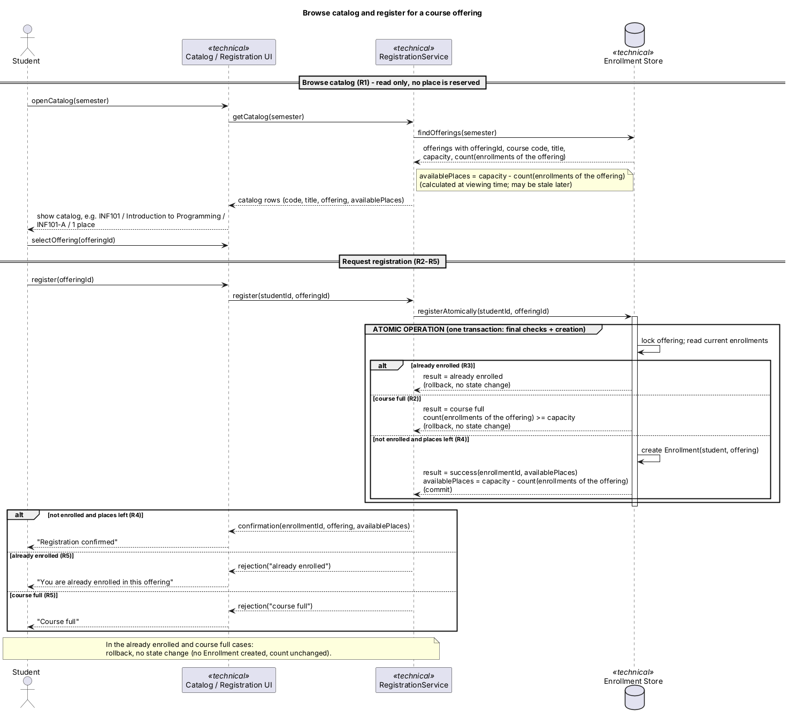
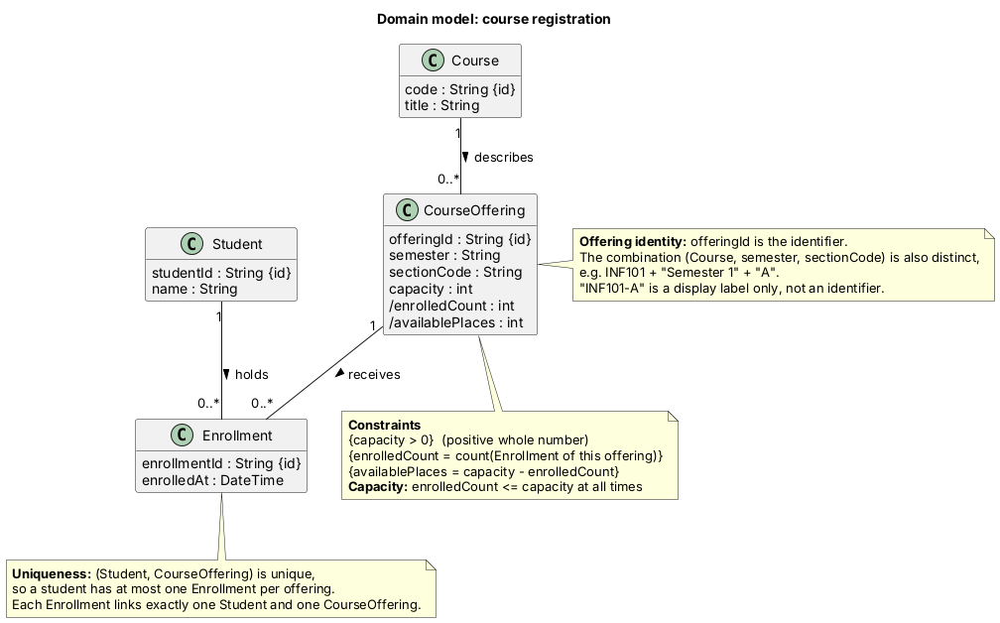
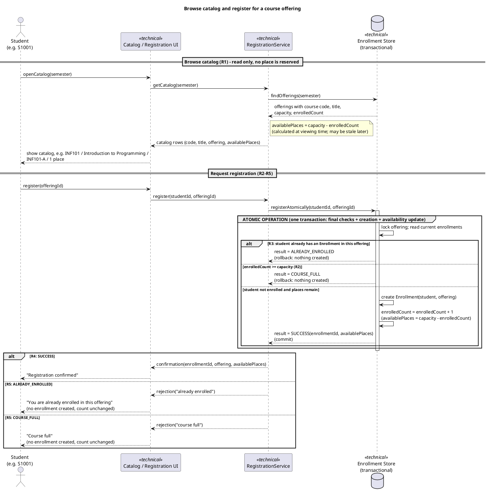
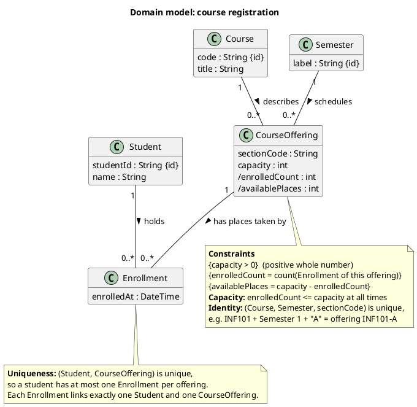
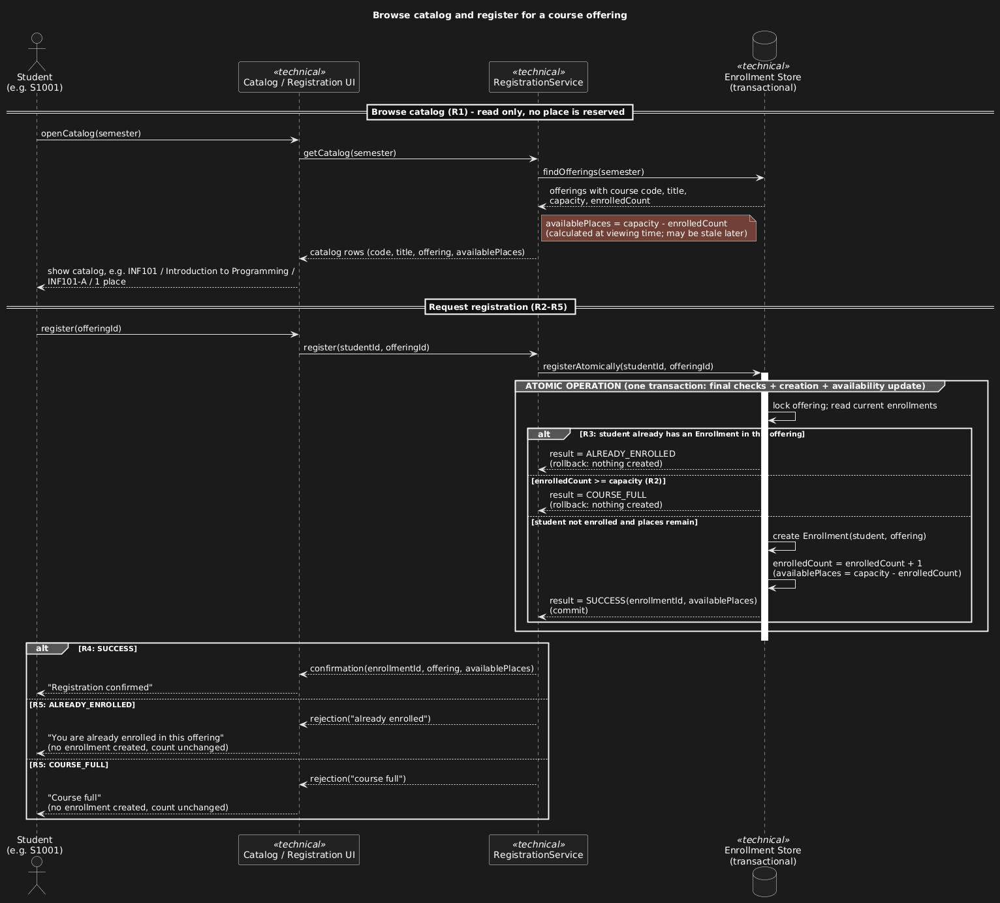
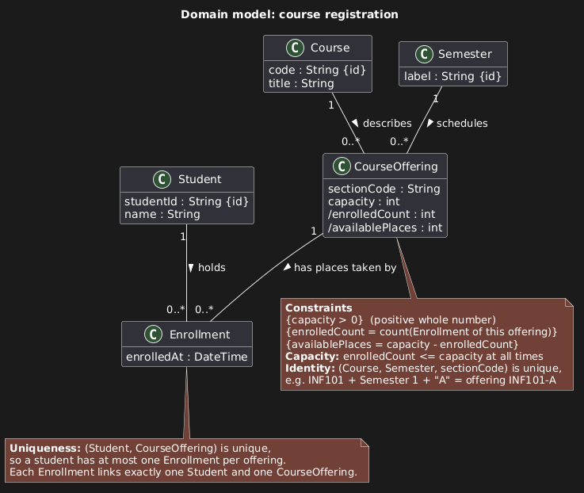

# SIS #02 — AI-Assisted UML Modeling: University Course Registration

<!--
  This is the only file you write your report in. README.md tells you what goes where.

  Rules the checker relies on:
  - Do not delete, rename or renumber the ## headings, the ### headings, or the **Label:** words.
  - Replace every "(write here)" and "(paste here)". None may be left when you submit.
  - Comments like this one are ignored by the checker and the word counter. Delete them or leave them.
-->

## 1. Scope and assumptions

<!-- Your FINAL scope statement and assumptions, after reviewing Prompt A's output. Say here
     what is out of scope (payments, prerequisites, timetable clashes, waiting lists,
     cancellation) — section 2 must not mention them. Section 10 keeps your first version. -->

**Scope:** (write here)

**Assumptions:**

1. (write here)
2. (write here)

## 2. User stories and acceptance criteria

### US-01 — Browse offerings

**US-01:** As a signed-in student, I want to see the course offerings for one semester with their available places, so that I can choose an offering to register for.

- **AC-01** (R1): Given Semester 1 has offering INF101-A (title "Introduction to Programming", capacity 2) with 1 Enrollment, When the student opens the catalog for Semester 1, Then the catalog shows the course code INF101, the title, the offering INF101-A and 1 available place.
- **AC-02** (R1): Given INF101-A has 2 Enrollments (capacity 2), When S1001 views the catalog, Then INF101-A is shown with 0 available places and the number of Enrollments for INF101-A is still 2 after viewing, because a catalog view does not take a place.

### US-02 — Register for an offering

**US-02:** As a signed-in student, I want to register for a chosen offering, so that I hold a place in that section.

- **AC-03** (R2, R3, R4): Given INF101-A has capacity 2 and 0 Enrollments, and S1001 has no Enrollment in it, When S1001 requests registration for INF101-A, Then the system rechecks current availability, creates exactly one Enrollment linking S1001 and INF101-A, updates availability to 1 place, and returns a confirmation to S1001.
- **AC-04** (R2, R4): Given INF101-A has capacity 2 and 1 Enrollment (S1001), and S1002 has none, When S1002 requests registration for INF101-A, Then exactly one Enrollment is created, INF101-A has 2 Enrollments (equal to capacity) and 0 available places, and S1002 receives a confirmation.

### US-03 — Receive a clear rejection

**US-03:** As a signed-in student, I want a clear reason when my registration fails, so that I know what happened and that nothing was recorded.

- **AC-05** (R2, R5): Given the catalog showed INF101-A with 1 available place to S1002, another student has since taken it so that INF101-A now has 2 Enrollments (capacity 2), and S1002 has no Enrollment in it, When S1002 requests registration for INF101-A, Then the system rechecks availability, rejects the request with the reason "course full", creates no Enrollment, and the Enrollment count stays at 2.
- **AC-06** (R3, R5): Given S1001 already has an Enrollment in INF101-A and INF101-A has places available, When S1001 requests registration for INF101-A again, Then the system rejects the request with the reason "already enrolled", creates no Enrollment, S1001 still has exactly one Enrollment in INF101-A, and the Enrollment count is unchanged.

## 3. Sequence diagram

<!-- The FINAL diagram, rendered. Change .png to .svg if that is what you exported. -->



**Participants:** (write here — each lifeline and what it stands for)

**Atomic operation:** (write here — which messages form the one atomic step: the final duplicate check, the capacity check and the creation of the Enrollment, and why a catalog view reserves nothing)

**Where the Enrollment is created:** (write here — which message, which lifeline, and which class in section 4 it produces)

**Technical lifelines:** (write here — every lifeline that is NOT a class in the class diagram, by name, and why the difference in abstraction is fine. "None" if there are none.)

## 4. Class diagram

<!-- The FINAL diagram, rendered. -->



<!-- One row per association in classes.puml, read in both directions. -->

| Association | Read left to right | Read right to left |
| --- | --- | --- |
| (write here) | (write here) | (write here) |
| (write here) | (write here) | (write here) |
| (write here) | (write here) | (write here) |

**How an Enrollment links a student to an offering:** (write here)

**Capacity constraint:** (write here — and why multiplicity alone cannot express it)

**Uniqueness constraint:** (write here — and why multiplicity alone cannot express it)

## 5. Traceability

<!-- Every rule, including the catalog fields and availability (R1). Column 1: the rule and
     the criteria that cover it, e.g. "R2 + AC-03, AC-04". Column 2: the message, guard,
     class or constraint that shows the rule in YOUR diagrams. Column 3: the T-ID that
     exercises it, or the extra check you did instead (R1 has no T case). -->

| Rule and criterion | Model evidence | Validation case |
| --- | --- | --- |
| R1 + (write here) | (write here) | (write here) |
| R2 + (write here) | (write here) | (write here) |
| R3 + (write here) | (write here) | (write here) |
| R4 + (write here) | (write here) | (write here) |
| R5 + (write here) | (write here) | (write here) |

## 6. Walkthroughs

<!-- Walk each case through YOUR final sequence diagram, message by message. Column 2: the
     actual steps and the state change (count before → after). Column 3 starts with Pass or
     Fail, then the location: the message, guard or note where you saw it. A Fail you
     report honestly is a finding, not a penalty. -->

| Case | Observed path and state change | Judgment and evidence |
| --- | --- | --- |
| T1. Available | (write here) | (write here) |
| T2. Last place | (write here) | (write here) |
| T3. Full | (write here) | (write here) |
| T4. Duplicate | (write here) | (write here) |

## 7. Review decisions

<!-- At least three substantive decisions about Prompt C's critique or your own inspection.
     Decision: accepted / rejected / modified — and what you did. Reason: why, in a full
     sentence. Rule: R1–R5. Do not invent an error to fill the table; a justified rejection
     of advice counts. -->

| AI suggestion or model element | Decision | Reason | Rule |
| --- | --- | --- | --- |
| (write here) | (write here) | (write here) | (write here) |
| (write here) | (write here) | (write here) | (write here) |
| (write here) | (write here) | (write here) | (write here) |

## 8. Modeling explanation

<!-- 200–300 words. Your main design choices; how the class diagram and the sequence diagram
     complement each other; why an activity diagram could also help explain the workflow. -->

(write here)

## 9. Reflection

<!-- 150–200 words. Written by you, not by the assistant: where AI helped, one decision you
     made yourself, one remaining limitation. Specific beats flattering. -->

(write here)

## 10. Appendix A — Before AI

<!-- Written BEFORE you run Prompt A, committed and pushed in your first commit, and never
     edited afterwards. This is what you paste into Prompt A as "My initial assumptions". -->

**Scope:** Modeling how a signed-in student registers for one course 
offering in one semester: browsing the catalog, final capacity and duplicate checks, 
creating one Enrollment, and issuing either a confirmation or a rejection reason.

**Initial assumptions:**

1. Students and courses are uniquely identified by student ID and course code, respectively.
2. A place is taken only when an Enrollment is created, not when the catalog is viewed;
the number of taken places equals the number of Enrollments for that offering.

## 11. Appendix B — AI exchanges

<!-- Complete prompts and complete responses, as text — never screenshots. Paste each inside
     the ~~~~ block that follows its label: AI responses contain ``` PlantUML blocks, and
     ~~~~ keeps them from breaking this file. Prompts B and C: the prompt text first, then
     the material it refers to ("below", "these two") pasted under it, in the same block.
     You may add B5, B6 … after B4 if you ran more. -->

### B1 — Requirements (Prompt A)

- **Tool:** Claude (claude.ai)
- **Model:** Claude Sonnet 5.5
- **Date:** 2026-10-18
- **Purpose:** draft 3 user stories and 6 acceptance criteria

<!-- Model: the exact model with its version, as the tool shows it (e.g. "GPT-5 Thinking",
     "Claude Sonnet 4.5"). If the tool does not show it, write: not displayed
     Date: YYYY-MM-DD -->

**Prompt:**

~~~~text
# Requirements: Course Registration

**Fictional data used:** students S1001 (Aiya), S1002 (Bek); course INF101 "Introduction to Programming"; offering INF101-A, Semester 1, capacity 2.

**Working definitions** (from your assumptions)
- Taken places = number of Enrollments for that offering.
- Available places = capacity − taken places.

---

## US-01: Browse the catalog
As a signed-in student, I want to see the course offerings for one semester with their available places, so that I can choose an offering to register for.

**AC-01: Catalog lists the semester's offerings** (R1)
- **Given** Semester 1 has offering INF101-A (title "Introduction to Programming", capacity 2) with 1 Enrollment
- **When** the student opens the catalog for Semester 1
- **Then** the catalog shows the course code INF101, the title, the offering INF101-A and 1 available place.

**AC-02: Viewing does not take a place; a full offering shows no places** (R1, R2)
- **Given** INF101-A has 2 Enrollments (capacity 2) and S1001 is not enrolled
- **When** S1001 views the catalog
- **Then** INF101-A is shown with 0 available places, and the number of Enrollments for INF101-A is still 2 after viewing.

---

## US-02: Register for an offering
As a signed-in student, I want to register for a chosen offering, so that I hold a place in that section.

**AC-03: Successful registration** (R2, R3, R4)
- **Given** INF101-A has capacity 2 and 0 Enrollments, and S1001 has no Enrollment in it
- **When** S1001 requests registration for INF101-A
- **Then** the system rechecks current availability, creates exactly one Enrollment linking S1001 and INF101-A, and shows 1 available place.
- **And** it returns a confirmation to S1001.

**AC-04: Registration takes the last place** (R2, R4)
- **Given** INF101-A has capacity 2 and 1 Enrollment (S1001), and S1002 has none
- **When** S1002 requests registration for INF101-A
- **Then** exactly one Enrollment is created, INF101-A has 2 Enrollments (equal to capacity) and 0 available places, and S1002 receives a confirmation.

---

## US-03: Understand why a registration is rejected
As a signed-in student, I want a clear reason when my registration fails, so that I know what happened and that nothing was recorded.

**AC-05: Rejection because the offering is full** (R2, R5)
- **Given** the catalog showed INF101-A with 1 available place, and before S1002 submits, another student takes it, so INF101-A now has 2 Enrollments (capacity 2)
- **When** S1002 requests registration for INF101-A
- **Then** the system rechecks availability and rejects the request with the reason "course full".
- **And** no Enrollment is created and the Enrollment count stays at 2.

**AC-06: Rejection because the student is already enrolled** (R3, R5)
- **Given** S1001 already has an Enrollment in INF101-A, and INF101-A has places available
- **When** S1001 requests registration for INF101-A again
- **Then** the system rejects the request with the reason "already enrolled".
- **And** no Enrollment is created, S1001 still has exactly one Enrollment in INF101-A, and the Enrollment count is unchanged.

---

## Traceability

| AC | Story | Type | Rules |
|---|---|---|---|
| AC-01 | US-01 | Normal | R1 |
| AC-02 | US-01 | Edge (full) | R1, R2 |
| AC-03 | US-02 | Normal | R2, R3, R4 |
| AC-04 | US-02 | Boundary | R2, R4 |
| AC-05 | US-03 | Rejection | R2, R5 |
| AC-06 | US-03 | Rejection | R3, R5 |

Every rule is covered: R1 by AC-01 and AC-02, R2 by AC-02 to AC-05, R3 by AC-03 and AC-06, R4 by AC-03 and AC-04, and R5 by AC-05 and AC-06.

---

## Uncertainties (not resolved here)

1. **Both rejection reasons apply.** If a student is already enrolled and the offering is also full, R5 does not say which reason to show. AC-05 and AC-06 are written so that only one condition holds at a time.
2. **Simultaneous requests.** R2 says enrollment must never exceed capacity, but not how two near-simultaneous requests for the last place are handled. AC-05 covers a stale catalog, not true concurrency.
3. **Identifying an offering.** The scenario does not say what uniquely identifies a CourseOffering (for example course code plus semester plus section). I used "INF101-A, Semester 1" for illustration only.
4. **How the semester is chosen in the catalog.** R1 says "one semester" but not whether the student picks it or the system supplies it.
5. **Zero-place offerings in the catalog.** R1 does not say whether full offerings must be listed. AC-02 assumes they are shown with 0 places.
6. **Confirmation content.** R4 says "return a confirmation" without saying what it contains. My criteria only require that one is returned.
7. **Different offerings of the same course.** R3 covers only the same offering. Whether a student may enroll in two offerings of the same course is not stated, and I have not added a rule for it.
8. **Rejection wording.** R5 gives only the two reasons, "course full" and "already enrolled". Exact message text and format are unspecified.
~~~~

**Response:**

~~~~text
# Requirements: Course Registration

**Fictional data used:** students S1001 (Aiya), S1002 (Bek); course INF101 "Introduction to Programming"; offering INF101-A, Semester 1, capacity 2.

**Working definitions** (from your assumptions)
- Taken places = number of Enrollments for that offering.
- Available places = capacity − taken places.

---

## US-01: Browse the catalog
As a signed-in student, I want to see the course offerings for one semester with their available places, so that I can choose an offering to register for.

**AC-01: Catalog lists the semester's offerings** (R1)
- **Given** Semester 1 has offering INF101-A (title "Introduction to Programming", capacity 2) with 1 Enrollment
- **When** the student opens the catalog for Semester 1
- **Then** the catalog shows the course code INF101, the title, the offering INF101-A and 1 available place.

**AC-02: Viewing does not take a place; a full offering shows no places** (R1, R2)
- **Given** INF101-A has 2 Enrollments (capacity 2) and S1001 is not enrolled
- **When** S1001 views the catalog
- **Then** INF101-A is shown with 0 available places, and the number of Enrollments for INF101-A is still 2 after viewing.

---

## US-02: Register for an offering
As a signed-in student, I want to register for a chosen offering, so that I hold a place in that section.

**AC-03: Successful registration** (R2, R3, R4)
- **Given** INF101-A has capacity 2 and 0 Enrollments, and S1001 has no Enrollment in it
- **When** S1001 requests registration for INF101-A
- **Then** the system rechecks current availability, creates exactly one Enrollment linking S1001 and INF101-A, and shows 1 available place.
- **And** it returns a confirmation to S1001.

**AC-04: Registration takes the last place** (R2, R4)
- **Given** INF101-A has capacity 2 and 1 Enrollment (S1001), and S1002 has none
- **When** S1002 requests registration for INF101-A
- **Then** exactly one Enrollment is created, INF101-A has 2 Enrollments (equal to capacity) and 0 available places, and S1002 receives a confirmation.

---

## US-03: Understand why a registration is rejected
As a signed-in student, I want a clear reason when my registration fails, so that I know what happened and that nothing was recorded.

**AC-05: Rejection because the offering is full** (R2, R5)
- **Given** the catalog showed INF101-A with 1 available place, and before S1002 submits, another student takes it, so INF101-A now has 2 Enrollments (capacity 2)
- **When** S1002 requests registration for INF101-A
- **Then** the system rechecks availability and rejects the request with the reason "course full".
- **And** no Enrollment is created and the Enrollment count stays at 2.

**AC-06: Rejection because the student is already enrolled** (R3, R5)
- **Given** S1001 already has an Enrollment in INF101-A, and INF101-A has places available
- **When** S1001 requests registration for INF101-A again
- **Then** the system rejects the request with the reason "already enrolled".
- **And** no Enrollment is created, S1001 still has exactly one Enrollment in INF101-A, and the Enrollment count is unchanged.

---

## Traceability

| AC | Story | Type | Rules |
|---|---|---|---|
| AC-01 | US-01 | Normal | R1 |
| AC-02 | US-01 | Edge (full) | R1, R2 |
| AC-03 | US-02 | Normal | R2, R3, R4 |
| AC-04 | US-02 | Boundary | R2, R4 |
| AC-05 | US-03 | Rejection | R2, R5 |
| AC-06 | US-03 | Rejection | R3, R5 |

Every rule is covered: R1 by AC-01 and AC-02, R2 by AC-02 to AC-05, R3 by AC-03 and AC-06, R4 by AC-03 and AC-04, and R5 by AC-05 and AC-06.

---

## Uncertainties (not resolved here)

1. **Both rejection reasons apply.** If a student is already enrolled and the offering is also full, R5 does not say which reason to show. AC-05 and AC-06 are written so that only one condition holds at a time.
2. **Simultaneous requests.** R2 says enrollment must never exceed capacity, but not how two near-simultaneous requests for the last place are handled. AC-05 covers a stale catalog, not true concurrency.
3. **Identifying an offering.** The scenario does not say what uniquely identifies a CourseOffering (for example course code plus semester plus section). I used "INF101-A, Semester 1" for illustration only.
4. **How the semester is chosen in the catalog.** R1 says "one semester" but not whether the student picks it or the system supplies it.
5. **Zero-place offerings in the catalog.** R1 does not say whether full offerings must be listed. AC-02 assumes they are shown with 0 places.
6. **Confirmation content.** R4 says "return a confirmation" without saying what it contains. My criteria only require that one is returned.
7. **Different offerings of the same course.** R3 covers only the same offering. Whether a student may enroll in two offerings of the same course is not stated, and I have not added a rule for it.
8. **Rejection wording.** R5 gives only the two reasons, "course full" and "already enrolled". Exact message text and format are unspecified.
~~~~

### B2 — UML drafts (Prompt B)

- **Tool:** Claude (claude.ai)
- **Model:** Claude Sonnet 5.5
- **Date:** 2026-10-18
- **Purpose:** draft the sequence and class diagrams

**Prompt:**

~~~~text
Using my approved scenario, R1–R5, stories and criteria below, return separate PlantUML code blocks for a sequence diagram and a domain class diagram.
Sequence: include catalog browsing and guarded success, full-course and duplicate outcomes. Model final checks and creation as one atomic operation.
Class: show domain concepts, useful attributes and multiplicities. State the capacity and uniqueness constraints. Explain assumptions and any technical lifelines.

Scenario: A student browses an electronic course catalog, chooses a course offering and requests registration. Each offering has a limited number of places. A Course describes a subject. A CourseOffering is one scheduled section in one semester. Registration always targets a specific offering. Assume that the student is signed in, the selected offering exists, and its capacity is a positive whole number. Exclude payments, prerequisites, timetable clashes, waiting lists and cancellation. Use fictional students and courses.

R1. Catalog: Show the course code, title, offering and available places for one semester.
R2. Capacity: Recheck current availability when registering. Enrollment must never exceed the offering's capacity.
R3. Duplicates: A student may have at most one enrollment in the same offering. Reject a repeat request.
R4. Success: Create exactly one Enrollment linking the student and offering, update availability and return a confirmation.
R5. Rejection: Explain "course full" or "already enrolled". Create no enrollment and leave the enrollment count unchanged.


```

### US-01 — Browse offerings

**US-01:** As a signed-in student, I want to see the course offerings for one semester with their available places, so that I can choose an offering to register for.

- **AC-01** (R1): Given Semester 1 has offering INF101-A (title "Introduction to Programming", capacity 2) with 1 Enrollment, When the student opens the catalog for Semester 1, Then the catalog shows the course code INF101, the title, the offering INF101-A and 1 available place.
- **AC-02** (R1): Given INF101-A has 2 Enrollments (capacity 2), When S1001 views the catalog, Then INF101-A is shown with 0 available places and the number of Enrollments for INF101-A is still 2 after viewing, because a catalog view does not take a place.

### US-02 — Register for an offering

**US-02:** As a signed-in student, I want to register for a chosen offering, so that I hold a place in that section.

- **AC-03** (R2, R3, R4): Given INF101-A has capacity 2 and 0 Enrollments, and S1001 has no Enrollment in it, When S1001 requests registration for INF101-A, Then the system rechecks current availability, creates exactly one Enrollment linking S1001 and INF101-A, updates availability to 1 place, and returns a confirmation to S1001.
- **AC-04** (R2, R4): Given INF101-A has capacity 2 and 1 Enrollment (S1001), and S1002 has none, When S1002 requests registration for INF101-A, Then exactly one Enrollment is created, INF101-A has 2 Enrollments (equal to capacity) and 0 available places, and S1002 receives a confirmation.

### US-03 — Receive a clear rejection

**US-03:** As a signed-in student, I want a clear reason when my registration fails, so that I know what happened and that nothing was recorded.

- **AC-05** (R2, R5): Given the catalog showed INF101-A with 1 available place to S1002, another student has since taken it so that INF101-A now has 2 Enrollments (capacity 2), and S1002 has no Enrollment in it, When S1002 requests registration for INF101-A, Then the system rechecks availability, rejects the request with the reason "course full", creates no Enrollment, and the Enrollment count stays at 2.
- **AC-06** (R3, R5): Given S1001 already has an Enrollment in INF101-A and INF101-A has places available, When S1001 requests registration for INF101-A again, Then the system rejects the request with the reason "already enrolled", creates no Enrollment, S1001 still has exactly one Enrollment in INF101-A, and the Enrollment count is unchanged.
```
~~~~

**Response:**

~~~~text
Both diagrams are below, followed by the assumptions and the technical lifelines.

## 1. Sequence diagram



## 2. Domain class diagram



## Assumptions

- **Check order:** if a request would fail both checks (the student is already enrolled and the offering is full), I report "already enrolled", because it is the more specific reason. Your criteria don't cover this case, so change the order if you prefer.
- **Atomic operation:** the final duplicate check, the capacity check, the creation of the Enrollment and the availability update form a single transaction. Two concurrent requests for the last place therefore can't both succeed, which is what R2 and AC-05 require. A rejection rolls back, so no Enrollment is created.
- **Catalog:** the catalog is read-only. The availability it shows can be stale by the time the student registers, which is why registration rechecks it (AC-05).
- **Derived attributes:** `enrolledCount` and `availablePlaces` are derived (marked `/`) from the Enrollment links, so they cannot drift from the real data.
- **Semester:** I modelled it as its own class because R1 filters the catalog by semester. If you only want a plain attribute on CourseOffering, it can be folded in.
- **Confirmation and rejection:** these are messages, not domain classes, so they appear only in the sequence diagram.
- **Excluded:** payments, prerequisites, timetable clashes, waiting lists and cancellation are not modelled. Sign-in is assumed, and the offering is assumed to exist.

## Technical lifelines

These are not domain concepts, so they appear only in the sequence diagram and are tagged `<<technical>>`:

- **Catalog / Registration UI:** the screen the student interacts with.
- **RegistrationService:** the application service that coordinates the use case and maps results to confirmation or rejection messages.
- **Enrollment Store (transactional):** the persistence layer that provides the atomic boundary. Locking, commit and rollback happen here, so the domain diagram does not need them.
~~~~

### B3 — Model critique (Prompt C)

- **Tool:** (write here)
- **Model:** (write here)
- **Date:** (write here)
- **Purpose:** review both models against R1–R5 and T1–T4

**Prompt:**

~~~~text
(paste here)
~~~~

**Response:**

~~~~text
(paste here)
~~~~

### B4 — Focused revision (Prompt D)

- **Tool:** (write here)
- **Model:** (write here)
- **Date:** (write here)
- **Purpose:** apply my accepted review decisions

**Prompt:**

~~~~text
(paste here)
~~~~

**Response:**

~~~~text
(paste here)
~~~~

## 12. Appendix C — Original diagrams

<!-- The AI's first output from Prompt B, rendered unedited from models/original/. -->





## 13. Appendix D — References and source checks

### References

<!-- Full references, one per line, each starting with "- ". Only sources you actually opened.
     Every URL used in the source checks must also appear here. Example:
     - Sommerville, I. (2016). Software Engineering, 10th ed., Global Edition. Pearson. Ch. 5. -->

- (write here)

### Source checks

<!-- At least two modeling decisions you verified. Source and locator: title + slide, page,
     section, chapter or figure — or title + URL + access date (YYYY-MM-DD). Slide numbers
     refer to the decks posted in our Teams. -->

| Modeling decision | Source and locator | What the source says | How it supports or changed your model |
| --- | --- | --- | --- |
| (write here) | (write here) | (write here) | (write here) |
| (write here) | (write here) | (write here) | (write here) |
